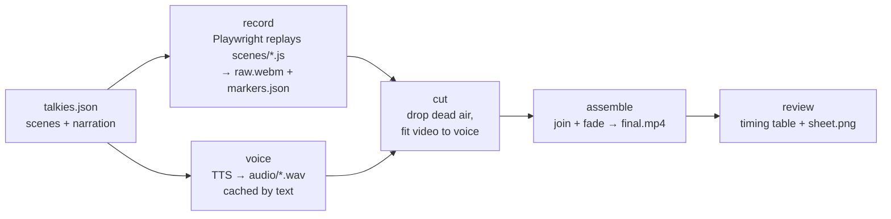

# How it works

## 1. Voice

Each scene's `narration` goes to the configured TTS provider. Whatever comes back is normalised by ffmpeg to 24 kHz mono WAV, with the silence trimmed at both ends, so pacing is decided only by the cut step. Clips are cached in `~/.cache/talkies/tts/`, keyed by sha256(provider, model, voice, style, text). Re-recording costs nothing, editing one line pays for one line, and every workspace on the machine shares the cache.

`--verify` sends each newly voiced line to a Gemini text model for transcription and compares the result with the script. The check exists because of a real failure mode: Gemini TTS has no field for delivery directions, and its models refuse system instructions. Inline directions, even as a `[bracketed]` audio tag, are sometimes read aloud. The verifier reports style words heard but not scripted, evicts that take from the cache, and flags any surplus words.

## 2. Record

One Chromium context, `recordVideo` at the viewport size (1280x720 by default), and an init script (`src/scene/cursor.js`) injected into every page. The script draws a cursor that follows real mouse events and a ripple on every press. Playwright teleports the mouse by default, so the `demo` helpers move it in 8–40 steps scaled by distance. The overlay then glides at a constant speed, and every click lands exactly where the cursor is.

Scenes run back to back in the same page, so cookies and app state carry over. The recorder notes each scene's start and end, plus every `demo.skip()` span, in seconds from the first video frame, and writes them to `out/markers.json`.

**Why not screen capture?** `recordVideo` runs headless and in CI, needs no display server, and produces exactly the viewport. Chromium's recorder uses VP8 at a fixed bitrate ([playwright#31424](https://github.com/microsoft/playwright/issues/31424)). For app UIs, a static frame from it is indistinguishable at 720p from a lossless CDP screencast, so the quality cost is negligible.

## 3. Cut

Dead air comes from two sources:

1. **Static video.** `ffmpeg -vf mpdecimate` drops every frame that matches its predecessor, and any gap of `CUT_MIN_FREEZE` (0.8 s) or more between the surviving frames counts as static. mpdecimate compares 8x8 blocks, so typing one character or moving a 22 px cursor counts as motion. The obvious alternative, `freezedetect`, averages the difference over the whole frame. On a real login form it classified the entire typing sequence as frozen and would have cut it.
2. **Declared waits.** Spans recorded by `demo.skip()`, such as spinners and slow requests. These move, so no detector would catch them, but nobody wants to watch them.

The two sets are merged. Within each scene's window, from its start to the next scene's start, every dead stretch keeps its first `CUT_KEEP` (0.4 s) and loses the rest, which reads as a quick beat rather than a jump cut.

Then comes the step that makes sync exact. Each scene's clip lasts `max(trimmed video, lead + speech + tail)`, and when the voice needs more time, the last frame is held (`tpad=stop_mode=clone`). **The video adapts to the voice, never the other way round.** Speech is never sped up, stretched or cut, and nobody has to hand-tune a wait to make a line fit.

Every clip carries its own audio track of exactly the clip's length: the narration delayed by the lead, or silence for a silent scene. Clips are near-lossless H.264 intermediates (CRF 12).

## 4. Assemble

The concat demuxer joins the clips without re-encoding, since they share codecs and parameters. One final encode adds the fade in and out: H.264 CRF 18, AAC 160 kbps and `+faststart`, so the video starts playing in a browser before it has fully downloaded.

## 5. Review

The review step exists so that an AI agent, which can't watch the video, can still judge it:

- a table with each scene's start, length and speech duration;
- an ffprobe line with the resolution, duration and whether there is audio;
- `out/sheet.png`, a grid with one row per scene showing its first and last frame. The last frame of the final scene is sampled just before the fade-out starts.

An agent reads the sheet the way a person skims a storyboard, and catches half-loaded pages, wrong final states or a stray open dropdown before anyone presses play.
